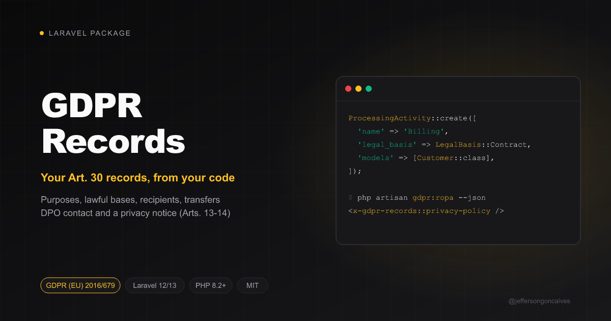

# Laravel GDPR Records



[](https://packagist.org/packages/jeffersongoncalves/laravel-gdpr-records)
[](https://github.com/jeffersongoncalves/laravel-gdpr-records/actions/workflows/tests.yml)
[](https://packagist.org/packages/jeffersongoncalves/laravel-gdpr-records)

The EU General Data Protection Regulation (GDPR) asks controllers to keep records of their processing activities (Art. 30), to publish the contact details of their data protection officer (Art. 37(7)), and to tell data subjects how their data is processed (Arts. 13 and 14). This package stores your processing activities and joins each one with the columns you declared in [laravel-gdpr](https://github.com/jeffersongoncalves/laravel-gdpr). Your records follow your code.

> This package gives you tooling. It does not make you compliant on its own. Your records need legal review.

## Installation

```bash
composer require jeffersongoncalves/laravel-gdpr-records
php artisan vendor:publish --tag="gdpr-records-migrations"
php artisan migrate
```

```dotenv
GDPR_CONTROLLER_NAME="Acme Ltd"
GDPR_CONTROLLER_ADDRESS="1 Example Street, Dublin"
GDPR_CONTROLLER_CONTACT=privacy@acme.example
GDPR_DPO_NAME="Anna Schmidt"
GDPR_DPO_EMAIL=dpo@acme.example
GDPR_SUPERVISORY_AUTHORITY="Data Protection Commission"
GDPR_SUPERVISORY_AUTHORITY_URL=https://www.dataprotection.ie
# Only when you are not established in the EU (Art. 27):
GDPR_REPRESENTATIVE_NAME="Rep GmbH"
GDPR_REPRESENTATIVE_CONTACT=rep@example.eu
```

## Processing activities

```php
use JeffersonGoncalves\Gdpr\Enums\LegalBasis;
use JeffersonGoncalves\GdprRecords\Models\ProcessingActivity;

ProcessingActivity::create([
    'name' => 'Billing',
    'purpose' => 'Issue invoices and collect payments',
    'legal_basis' => LegalBasis::Contract,
    'data_subjects' => ['customers'],
    'models' => [Customer::class],                     // its #[PersonalData] columns join the record
    'data_categories' => ['payment history'],          // anything not declared on a model
    'recipients' => [['name' => 'Stripe', 'role' => 'processor', 'country' => 'US']],
    'international_transfers' => [['country' => 'US', 'mechanism' => 'standard_clauses']],
    'retention' => '5 years after the end of the contract',
    'security_measures' => 'Encryption at rest, role-based access, audit log',
]);
```

- `role`: `processor`, `controller` (another or joint controller) or `public_authority`.
- `mechanism`: the Chapter V ground for a transfer outside the EEA: `adequacy` (Art. 45), `standard_clauses`, `binding_corporate_rules` or `codes_certification` (Arts. 46 and 47), or `derogation` (Art. 49).

## Export

```bash
php artisan gdpr:ropa          # one row per activity
php artisan gdpr:ropa --json   # controller, representative, DPO and every activity, ready to hand to the supervisory authority
```

```php
GdprRecords::export();   // the same, as an array
```

The command warns you when the DPO contact is missing.

## Data protection officer

Publish the data protection officer's contact details (Art. 37(7)):

```blade
<x-gdpr-records::dpo label="Data protection officer" class="text-sm" />
```

It renders the name, a `mailto:` link and a `tel:` link, and renders nothing until a DPO is configured.

## Privacy notice

Your privacy notice must tell data subjects who you are, the purposes and lawful basis of each processing, the recipients, transfers outside the EEA, how long you keep the data, their rights and that they can complain to a supervisory authority (Arts. 13 and 14). The records already hold all of that, so render the notice from them:

```blade
{{-- resources/views/privacy.blade.php, inside your layout --}}
<x-gdpr-records::privacy-policy rights-url="{{ route('privacy.requests') }}" class="prose" />
```

It renders the controller, the EU representative, the DPO, one section per processing activity, the rights of Arts. 15 to 22 and the right to complain to the supervisory authority you configured. When an activity relies on consent, it also says that consent can be withdrawn at any time. Each activity lists its purpose, lawful basis, data (its `data_categories` plus its declared columns, flagged when they are special or criminal data), data subjects, recipients, transfers and retention. The last-updated date comes from the activities, so the notice changes when your records change. Without `rights-url` it points readers to the DPO.

Texts ship in English, German, French and Spanish and follow the app locale. Publish them (`--tag="gdpr-records-translations"`) or the view (`--tag="gdpr-records-views"`) to change the wording. The markup is plain semantic HTML with no styles, so your CSS (or `prose`) decides how it looks.

> Generating the notice from the records keeps the two in sync. It still needs legal review, like the records themselves.

## Testing

```bash
composer test
```

## Changelog

See [CHANGELOG](CHANGELOG.md).

## License

The MIT License (MIT). See [License File](LICENSE.md).
